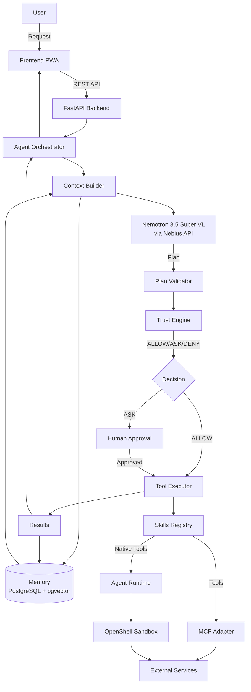
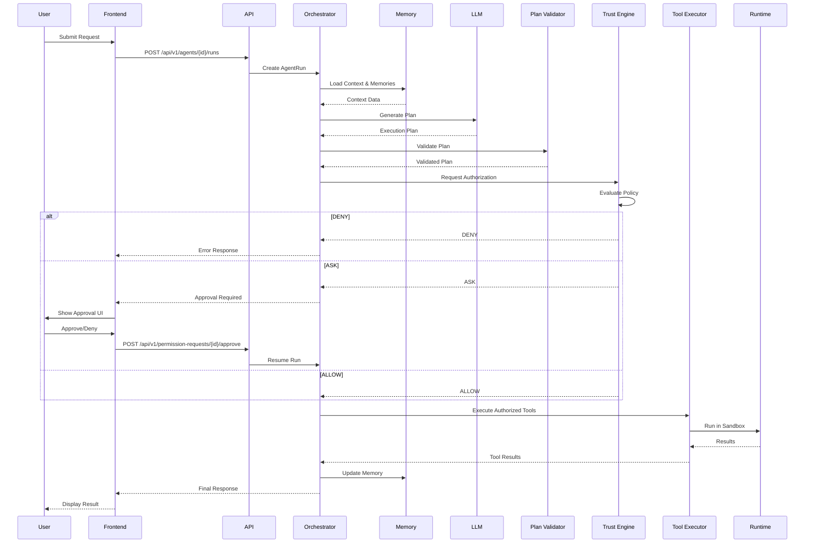
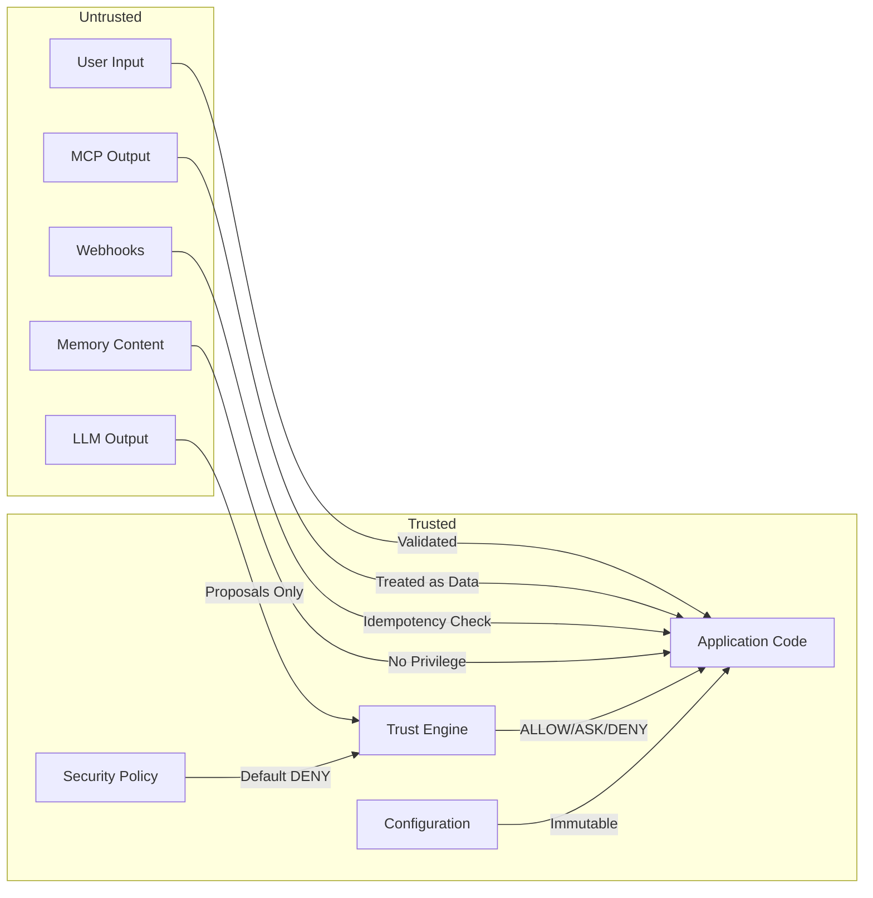
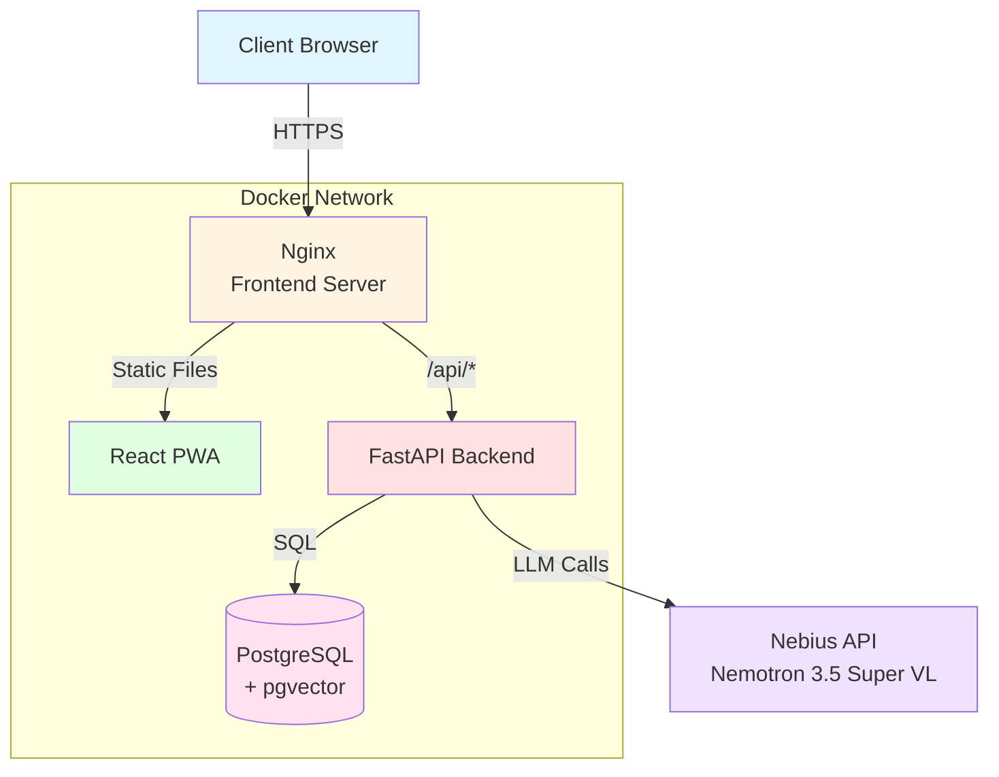
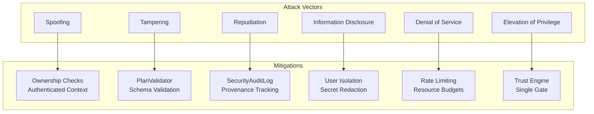
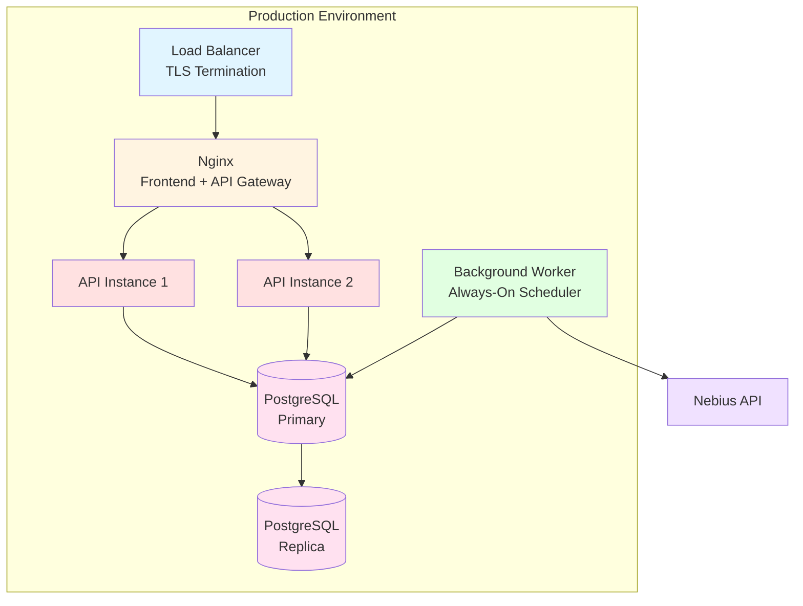

# NEXUS - Personal AI Operating System



> **Note**: Diagrams render natively in GitHub/GitLab. For local viewing, see [docs/images/README.md](docs/images/README.md) for rendering instructions.

NEXUS is a persistent Personal AI system for the Nebius Global AI Hackathon 2026. It integrates persistent memory, agent orchestration, Trust Engine, human-approval permissions, MCP, Agent Runtime/Sandbox, Always-On/Scheduled Jobs, and a PWA frontend.

## Table of Contents

- [Architecture](#architecture)
- [Core Components](#core-components)
- [Quick Start](#quick-start)
- [Development](#development)
- [Security](#security)
- [Deployment](#deployment)
- [Technology Stack](#technology-stack)

## Architecture

### System Overview

NEXUS follows a strict security-first architecture where the LLM proposes actions but never authorizes or executes them directly. All execution decisions go through the Trust Engine with explicit human approval for high-risk operations.



### Request Flow



### Security Boundaries



## Core Components

### Memory System

Persistent, ownership-scoped memory with three types:

- **Episodic Memory**: Interactions, events, and previous actions
- **Semantic Memory**: Facts and relevant knowledge
- **Preference Memory**: Recurring user decisions and preferences

**Technology**: PostgreSQL with optional pgvector semantic retrieval. `MEMORY_SEARCH_MODE=keyword` is the offline default; `semantic` requires an explicitly configured embedding provider. The Memory Firewall rejects secrets before persistence. See [secure setup and integrations](docs/secure-setup.md).

### Agent Orchestrator

Coordinates agent work through a documented pipeline:

1. Receive user request
2. Load user context (memories, preferences)
3. Retrieve relevant memories using the configured keyword or pgvector semantic mode
4. Generate executable execution plan
5. Validate plan with PlanValidator
6. Consult Trust Engine (ALLOW/ASK/DENY decisions)
7. Execute authorized actions via Tool Executor
8. Observe results
9. Prepare final response and update memory

**Key Principle**: The LLM proposes, the Trust Engine decides. No action executes without authorization.

### Trust Engine

Security decision engine with three possible outcomes:

| Decision | Meaning |
|----------|---------|
| **ALLOW** | Action authorized by applicable policies |
| **ASK** | User confirmation required |
| **DENY** | Action must be blocked |

Considers: action type, risk level, user permissions, and affected resource. **Invariant**: If `requires_confirmation=True`, always returns ASK even if policy says ALLOW.

### Skills & Tools

Reusable skills grouping related tools following the Ports and Adapters pattern:

| Skill | Tools | Category |
|-------|-------|----------|
| **Tasks** | create, list, get, update, complete | productivity |
| **Memory** | save, search, get, delete | knowledge |
| **GitHub** | list_repos, get_repository, read_contents, create_issue, create_pull_request | development |
| **Calendar** | create_event, list_events | productivity |
| **Web** | search, fetch | knowledge |
| **Files** | search, read, docs.extract | files |
| **Knowledge** | ingest, search | knowledge |
| **Email** | list, read, draft | email |
| **Reminders** | create, list | reminders |
| **Docker** | logs | docker |
| **Git** | diff | git |

Each skill exposes concrete operations via `SkillDefinition` and `ToolDefinition`, enabling new capabilities without core system changes.

#### Read-only data tools

`files.*`, `docs.extract`, `knowledge.search`, `email.list`, `email.read`, `docker.logs` and
`git.diff` are read-only. The workspace is mounted read-only at `/workspace`; credential-like
names such as `.env`, private keys and `.netrc` are refused even when they are inside it.
`docker.logs` accepts only container names matching `DOCKER_ALLOWED_CONTAINERS` and writes
nothing to the Engine API. `git.diff` runs only `git diff`/`rev-parse` inside `GIT_REPO_PATH`,
with external diff drivers and textconv disabled, a timeout and an output cap.

`knowledge.ingest`, `email.draft` and `reminder.create` are side-effecting and therefore go
through the Trust Engine like any other mutating tool. `email.draft` appends to the IMAP
Drafts mailbox and reports `sent=false`; there is deliberately no `email.send` tool yet.
Email tools return `EMAIL_NOT_CONFIGURED` until `EMAIL_ENABLED=true` and the IMAP values are
supplied. `knowledge` uses local chunking and keyword retrieval; it does not call an external
embedding provider.

### MCP Integration

Model Context Protocol as a standardized integration layer:

```
Orchestrator → Plan Validator → Trust Engine → MCP/Tool Registry → Tool Executor
```

Registration accepts `stdio`, SSE and streamable HTTP, including stored headers for
remote transports. It stores configuration only: connecting remains a separate act
gated by the Trust Engine. The orchestrator discovers enabled MCP tools before planning; each discovered tool call still requires authorization.

Tool responses are treated as potentially untrusted data to reduce prompt injection risks.

### Agent Runtime & Sandbox

OpenShell-backed sandbox execution with:

- Workspace containment
- Command/network/filesystem/process limits
- Per-session budgets and timeouts
- No host fallback (fail-closed)

**Guarantees**:
- No Trust Engine ALLOW = No execution
- No authorization replay
- Paths stay inside workspace
- Network egress DENY by default
- Secrets never enter sandbox

### Always-On / Scheduled Jobs

Proactive agent execution triggered by schedules or events (reminders, periodic research, meeting preparation).

**Deterministic Conditions**:
- `DAILY_AT_TIME`
- `DAY_OF_WEEK`
- `IDLE_FOR`
- `TASK_OVERDUE`

**Key Invariants**:
- Scheduling grants no authority - every execution re-enters Trust Engine
- Exactly-once semantics via database constraints
- Crashed runs fail visibly, never silently retry

## Quick Start

### Using Docker (Recommended)

```bash
# 1. Copy environment configuration
python scripts/setup_local.py
cp frontend/.env.example frontend/.env

# 2. Configure required variables
# Edit backend/.env with your NEBIUS_API_KEY
# Open .nexus-access-key locally to get your login key; keep it private.
# Existing database volume: follow docs/secure-setup.md before starting.
# Edit frontend/.env with your API URL if needed

# 3. Start the full stack
docker compose up --build

# 4. Access the application
# Frontend: http://localhost:3000
# API: http://localhost:3000/api/v1 (Authorization: Bearer <access-key>)
# PostgreSQL and backend ports are internal to Compose.
```

### Docker Compose Architecture



## Development

### Prerequisites

- Python 3.11+
- Node.js 18+
- PostgreSQL 15+ with pgvector extension
- Docker (optional, for containerized development)

### Backend Development

Run `python scripts/setup_local.py` from the repository root first. The API requires an operator access key in development too. For local PostgreSQL, set `DATABASE_URL` in `backend/.env` to its actual credentials.

```bash
cd backend

# Install dependencies
pip install -r requirements.txt

# Configure environment
cp .env.example .env
# Edit .env with your configuration

# Run database migrations
alembic upgrade head

# Start development server
uvicorn app.main:app --reload

# Run tests
pytest

# Run tests with coverage
pytest --cov=app --cov-report=html
```

### Frontend Development

```bash
cd frontend

# Install dependencies
npm install

# Start development server
npm run dev

# Build for production
npm run build

# Run tests
npm test
```

### Database Migrations

```bash
cd backend

# Create new migration
alembic revision --autogenerate -m "description"

# Apply migrations
alembic upgrade head

# Rollback one migration
alembic downgrade -1

# View migration history
alembic history
```

## Security

All user APIs require a bearer access key, including permission approvals. This is a single-operator application; key rotation preserves existing ownership. Missing authentication configuration closes the API. Health probes and the separately authenticated event webhook are the only exceptions. See [secure setup](docs/secure-setup.md).

### Security Invariants (Phase 13)

1. **LLM cannot authorize itself** - Trust Engine is the sole authority
2. **LLM cannot directly execute tools** - All execution goes through Tool Executor
3. **Fail-closed by default** - `trust_default_decision: DENY`
4. **No host fallback** - Runtime failure never degrades to host execution
5. **Ownership isolation** - All resources scoped by user ownership
6. **Memory as context, not policy** - Stored memory cannot modify security policy
7. **Secret blocking** - Memory Firewall refuses to store credentials
8. **Prompt injection defense** - Detection and fencing of untrusted data
9. **Explicit authorization required** - Sandbox tools need ExecutionAuthorization
10. **Audit trail** - All security decisions logged with provenance

### Threat Model



For detailed security documentation, see:
- [docs/security.md](docs/security.md)
- [docs/threat_model.md](docs/threat_model.md)
- [docs/sandbox.md](docs/sandbox.md)

## Deployment

### Deployment Architecture



### Docker Deployment

```bash
# Build images
python scripts/setup_local.py
docker compose build

# Start production stack
docker compose up -d

# Check health
docker compose ps
curl http://localhost:3000/api/v1/health

# View logs
docker compose logs -f
```

### Deployment Checklist

- [ ] Secrets not in images
- [ ] HTTPS enabled
- [ ] CORS restricted to allowed origins
- [ ] Debug mode disabled
- [ ] Security headers active
- [ ] Database not publicly exposed
- [ ] Health checks configured
- [ ] Graceful shutdown tested
- [ ] Log aggregation configured
- [ ] Monitoring/alerting configured

For detailed deployment documentation, see:
- [docs/deployment-checklist.md](docs/deployment-checklist.md)

## Technology Stack

### Backend

| Component | Technology | Purpose |
|-----------|-----------|---------|
| **API Framework** | Python + FastAPI | REST API and application logic |
| **Database** | PostgreSQL + pgvector | Persistence; optional configured semantic search |
| **LLM** | NVIDIA Nemotron 3.5 Super VL | Agent reasoning via Nebius API |
| **Migrations** | Alembic | Database schema management |
| **Testing** | pytest + pytest-asyncio | Automated testing |
| **Sandbox** | OpenShell | Isolated execution environment |

### Frontend

| Component | Technology | Purpose |
|-----------|-----------|---------|
| **Framework** | React + TypeScript | Progressive Web App |
| **Build Tool** | Vite | Fast development and production builds |
| **HTTP Client** | Fetch | Authenticated same-origin API communication |
| **State Management** | React Context | Application state |

### Infrastructure

| Component | Technology | Purpose |
|-----------|-----------|---------|
| **Containerization** | Docker | Application packaging |
| **Reverse Proxy** | Nginx | Frontend serving and API gateway |
| **Orchestration** | Docker Compose | Multi-container management |
| **Process Management** | Uvicorn | ASGI server |

## Documentation

- [Architecture](docs/architecture.md) - Detailed architecture contract
- [Security](docs/security.md) - Security architecture and invariants
- [Threat Model](docs/threat_model.md) - STRIDE analysis and mitigations
- [Sandbox](docs/sandbox.md) - Runtime isolation guarantees
- [Always-On](docs/always_on.md) - Scheduled jobs and proactive rules
- [Deployment Checklist](docs/deployment-checklist.md) - Production deployment guide
- [DEVPOST](docs/DEVPOST.md) - Hackathon submission details

## License

See [LICENSE](LICENSE) file for details.

## Acknowledgments

Built for the **Nebius Global AI Hackathon 2026** in the **Personal AI** category.

- NVIDIA Nemotron models via Nebius Token Factory
- OpenShell for sandbox execution
- Model Context Protocol (MCP) for tool integration
